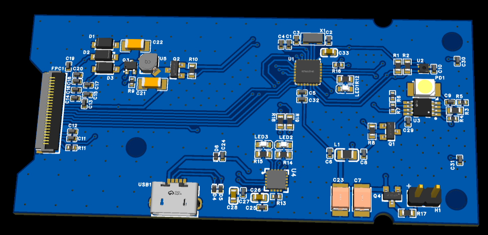
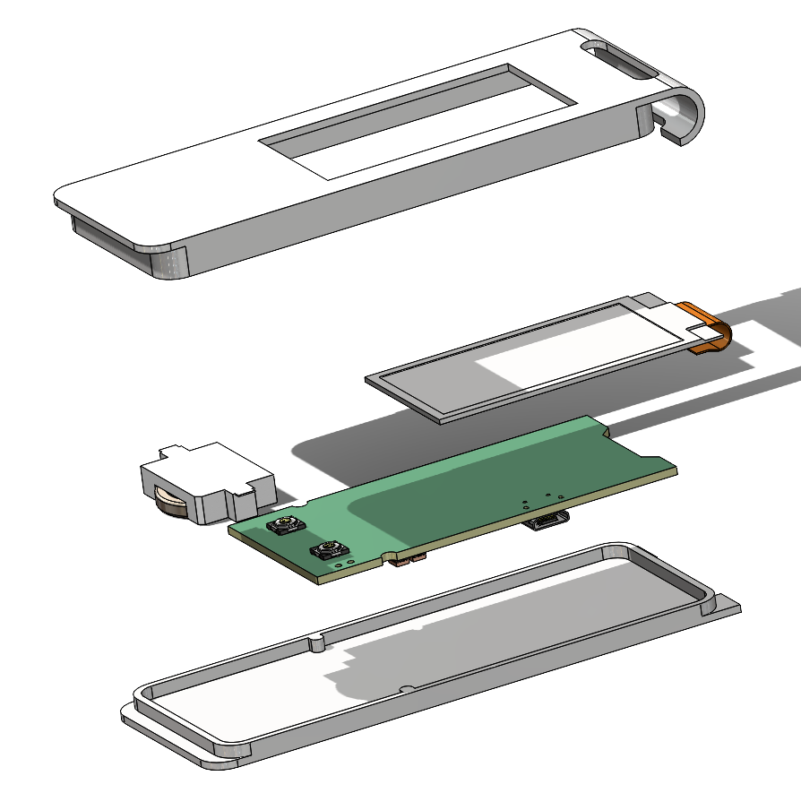
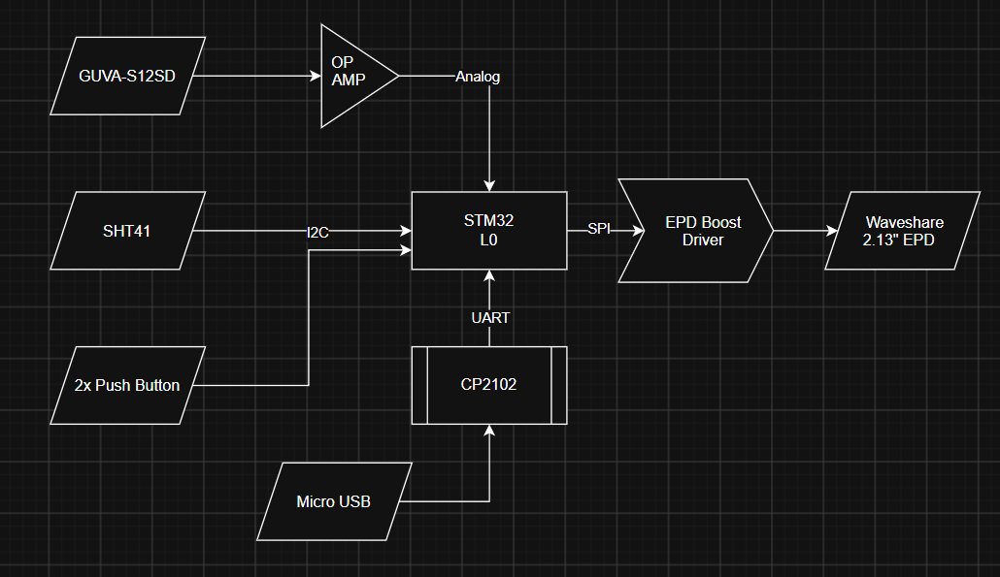
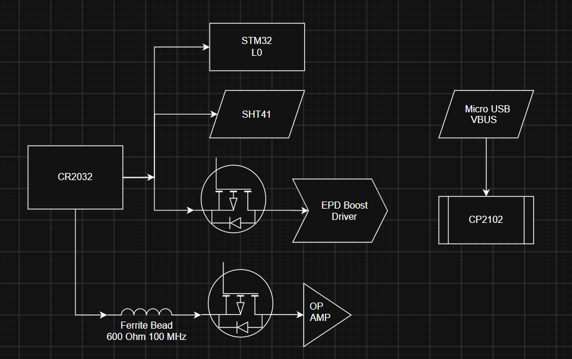
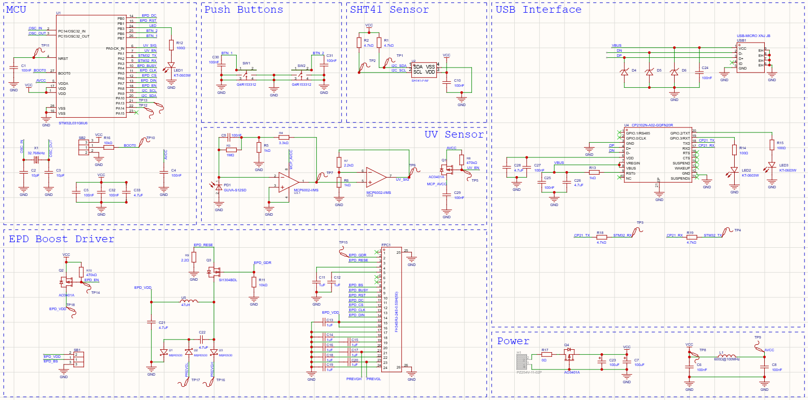

# AtmosTag [Work In Progress]
## General Description

AtmosTag is an ultra-low-power, pocket-sized device featuring a 2.13-inch e-ink display, designed for persistent visual data presentation and environmental monitoring on a single coin cell battery.

AtmosTag circuitry is laid out on a **small PCB**, smaller than a credit card. With many features and small size, **0603 and 0402** components are not optional. There are multiple of those components, and hand soldering them won't be easy. PCBA is the solution. But because **PCBA is a costly process**, the design has to be engineered so much so that it comes **right the first time**.

## But Why?
1. I live in a tropical valley, and the weather is rather unpredictable. I can't tell if it's just me or if the weather is actually cold. I bought myself an oral thermometer, but it didn't help much. I want to monitor real-time temperature and humidity in my environment.
2. This project is meant to be my personal engineering project to advance and practice what I have learned:
    * STM32
    * Analog Circuitry (UV Sensor)
    * Communication Protocols (SPI: E-Ink, I2C:SHT41, UART: USB)
    * Enclosure Design
    * etc.

## Design Diagrams
1. System Block Diagram

2. Power Block Diagram

3. Schematic Diagram (v1.4)

## Technical Specifications
* **Microcontroller**:  STM32L031
* **Display**:  2.13-inch monochrome e-ink panel driven by  an on-board SSD1680 
controller circuit.
* **Environmental Sensing**:  SHT41 high-precision temperature  and humidity sensor. 
GUVA-S12SD with TIA and OP-AMP to monitor UV Index.
* **Power & Boost Architecture**:  Powered by a CR2032 coin  cell battery, featuring a 
tightly clustered high-voltage boost converter (SSD1680 reference design 
generating +22V VGH and -20V VGL rails) with 25v-50v rated output capacitors.
* **Connectivity & Updates**:  micro usb connector paired  with a CP2102 
USB-to-UART bridge, allowing users to flash custom 4.7 KB bitmap images and 
update configurations via desktop utility.

## Constraints
* Maximum Deadline: By the end of January
* First-Time-Right PCB: 
    * PCB should work for the first time without any redesign.
    * Reworks (replace components, jumpers, etc.) are acceptable.
* The whole circuitry is powered by 200 mAh Coin Cell Battery (CR2032) and have 
minimum life expectancy of 6 months.
*  The whole circuitry, screen, and its enclosure should fit into a pocket (max: 4cm * 
10cm * 2cm).

## Other Links
* [Datasheets and Design References (GDrive)](https://drive.google.com/drive/u/1/folders/1WAnapc0iEL9AUcHYHtRPcmIaRS87K-GZ)