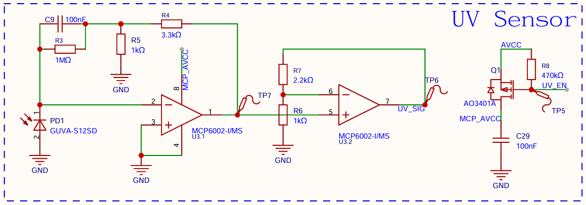
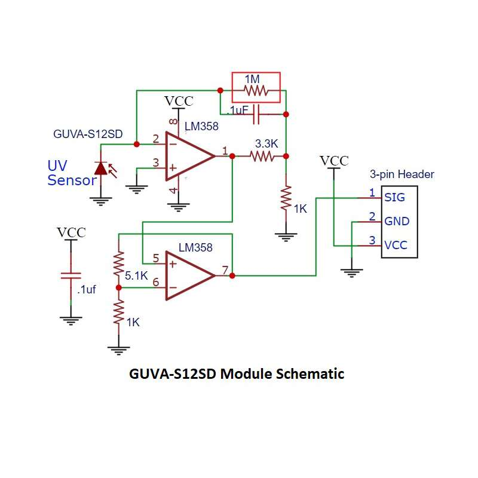
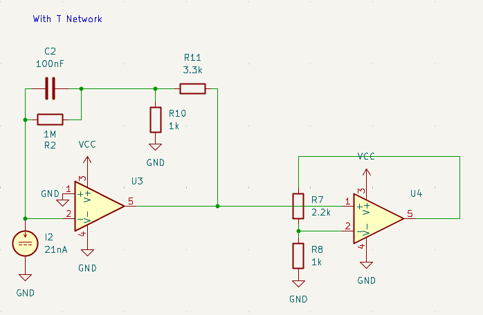
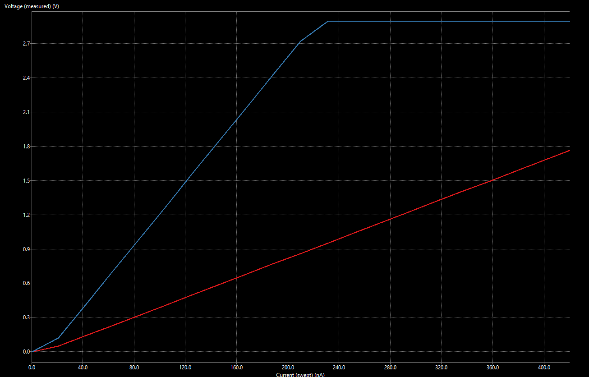
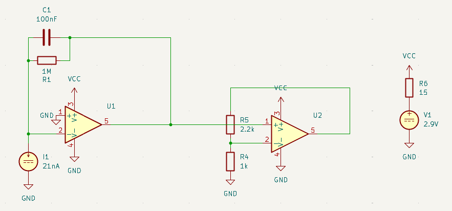
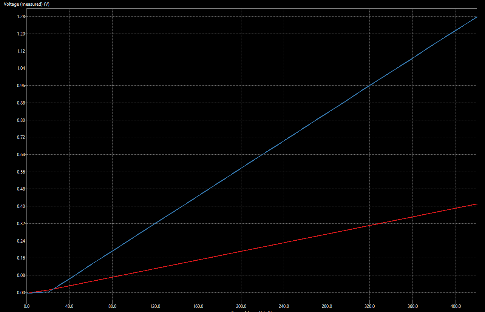

# GUVA-S12SD UV Sensor
```
Date    : 26.10.24
Subject : UV Sensor Front-end Design Change
```

## Current Design (v1.4)

_Fig. 1: UV Sensor Front-end Design v1.4_



_Fig. 2: Typical GUVA-S12SD Module Schematic used as reference_

Current Front-end design is just a copy from typical GUVA-S12SD module schematic. It only replaces 3.3k resistor with 2.2k (R7), and LM358 with MCP6002 for better power efficiency.

The change of resistor value is intended to match the output voltage maximum value with STM32L0s' VREFINT (about 1.20V). Unfortunately, it doesn't.

I ran a simulation with KiCAD NGSPICE, the graph is shown in Fig. 3 and Fig. 4.

_Fig. 3 Schematic with T-Network_


_Fig. 4 Simulation Result with T-Network_

A typical GUVA-S12SD photodiode can source current from 0-360nA with 21nA increments, the current of that photodiode is represented by the X-axis. That current is then processed and turned into voltage linearly by the first Op-Amp (U3) configured as Transimpedance-Amplifier. Then the signal is amplified one more time by the second Op-Amp (U4), which makes the output signal goes higher.

Before I ran this simulation, I have tried that GUVA-S12SD module, then replace the resistors and op-amp ic. When the photodiode is lit by UV source, the voltage can reach about 1.45V which is higher than the VREFINT.

## The Change: Remove T-Network
After consulting with some LLMs, the probable cause is those two resistors (R11 and R10), which turn the Transimpedance-Amplifier stage into a T-Network.

A standard Transimpedance-Amplifier uses the feedback resistor (R2: 1M Ohm) to determine the gain. For example, 100nA will be converted to 100mV on that circuit because 100n * 1M = 100m (1M gain on first stage).

But by adding those two resistors, the gain value is multiplied. On a T-Network, the effective resistance follows this formula: Req = R1 + R3 + (R1 * R3) / R2. With my circuit's values, it becomes 1M + 3.3k + 3.3M = ~4.3M. That means a 4.3M gain on the first stage instead of just 1M.

The solution is to remove the T-Network resistors entirely. As shown in Fig. 5 and Fig. 6, the maximum voltage now aligns with the STM32's VREFINT.


_Fig. 5 Schematic without T-Network_


_Fig. 6 Simulation Result without T-Network_

## Appendix
_Table 1: Simulation Result Data_
| Photodiode Current (nA) | TIA Output (Without T-Net) [V] | Final Output (Without T-Net) [V] | TIA Output (With T-Net) [V] | Final Output (With T-Net) [V] |
|------------------------:|-------------------------------:|---------------------------------:|----------------------------:|------------------------------:|
|                       0 |                        -0.0046 |                          -0.0048 |                     -0.0047 |                       -0.0048 |
|                      21 |                         0.0110 |                           0.0032 |                      0.0474 |                        0.1195 |
|                      42 |                         0.0320 |                           0.0704 |                      0.1377 |                        0.4086 |
|                      63 |                         0.0530 |                           0.1376 |                      0.2281 |                        0.6977 |
|                      84 |                         0.0740 |                           0.2048 |                      0.3184 |                        0.9867 |
|                     105 |                         0.0950 |                           0.2719 |                      0.4088 |                        1.2758 |
|                     126 |                         0.1160 |                           0.3391 |                      0.4991 |                        1.5649 |
|                     147 |                         0.1370 |                           0.4063 |                      0.5895 |                        1.8540 |
|                     168 |                         0.1580 |                           0.4735 |                      0.6798 |                        2.1430 |
|                     189 |                         0.1790 |                           0.5407 |                      0.7702 |                        2.4321 |
|                     210 |                         0.2000 |                           0.6079 |                      0.8605 |                        2.7212 |
|                     231 |                         0.2210 |                           0.6751 |                      0.9509 |                        2.8961 |
|                     252 |                         0.2420 |                           0.7422 |                      1.0412 |                        2.8964 |
|                     273 |                         0.2630 |                           0.8094 |                      1.1316 |                        2.8965 |
|                     294 |                         0.2840 |                           0.8766 |                      1.2219 |                        2.8966 |
|                     315 |                         0.3050 |                           0.9438 |                      1.3123 |                        2.8967 |
|                     336 |                         0.3260 |                           1.0110 |                      1.4026 |                        2.8967 |
|                     357 |                         0.3470 |                           1.0782 |                      1.4930 |                        2.8968 |
|                     378 |                         0.3680 |                           1.1454 |                      1.5833 |                        2.8968 |
|                     399 |                         0.3890 |                           1.2125 |                      1.6737 |                        2.8968 |
|                     420 |                         0.4100 |                           1.2797 |                      1.7640 |                        2.8969 |