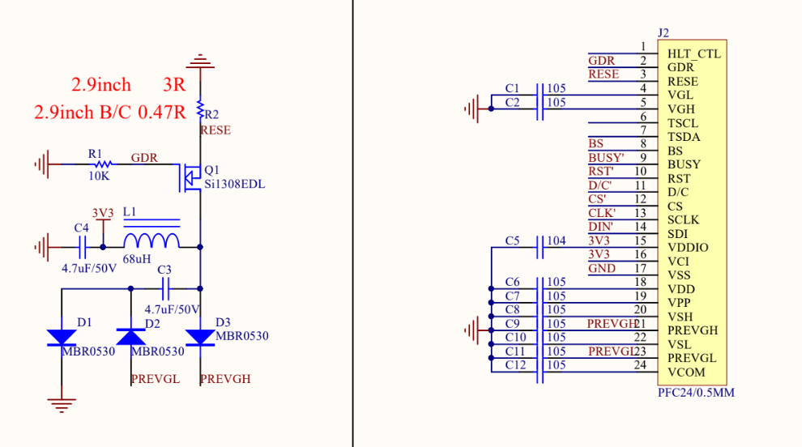
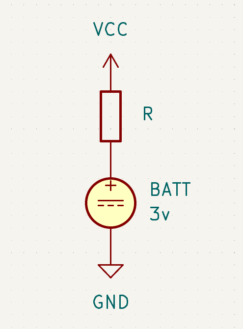
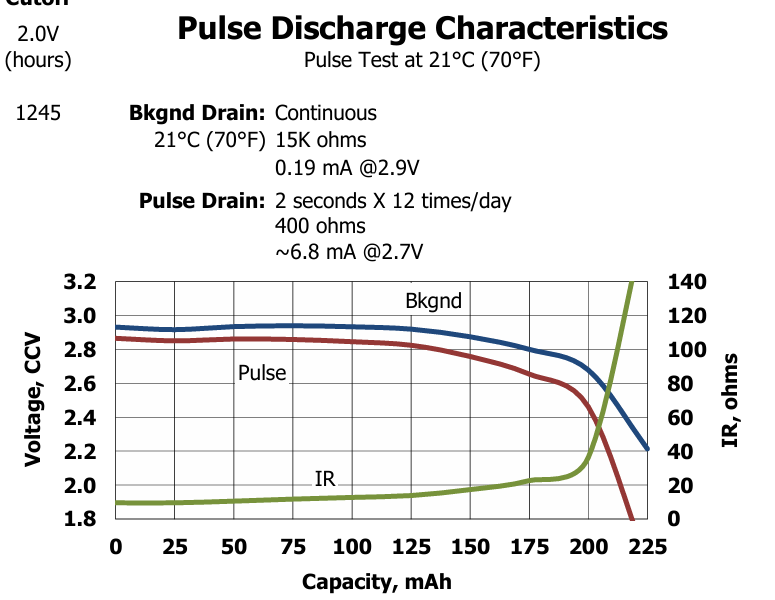

# CR2032 Characteristics vs EPD Boost Driver Current Spike
```
Date    : 26.10.25
```
## Current Spike of EPD Driver
In order to update the e-ink display, high positive and negative voltage is required. Those voltage will be used to physically move the ink particles up and down. Those high voltage are usually generated by a boost converter. Fig. 1 shows typical boost converter circuit to drive the E-Ink display with 24 pin fpc connector.



_Fig. 1: Typical Boost Driver Circuit (Waveshare 2.9" E-Ink Module)_

But, the boost converter circuitry can reach up to 50mA current draw (spike). Though the durations is only a matter of microseconds, it can be a problem if the circuitry is powered by CR2032 battery.

## CR2032 Characteristic
CR2032 supply 3v voltage when it's fresh, and the voltage degrades down to 2v after fully consumed. It has internal resistance, typically 15 ohm when it's fresh and goes up throughout the times (up to 120 ohm!). The internal resistance can be modeled as resistor in series with the battery.


_Fig. 2: Internal Resistance of CR2032 Battery_



_Fig. 3: Pulse discharge characteristics of Energizer CR2032 Battery. The x axis represent used capacity._

## The Problem

* The EPD can create 20mA-50mA current spike.
* Internal resistance of CR2032 goes up throughout the time.

With ohm's law, that current spike can create voltage drop. We can calculate the voltage drop = i * r.

For 20mA of spike when the internal resistance is 15 ohm, it can drop the power line about 0.3v. That means, it can drop 2.9v battery to 2.6v.

This voltage drop is dangerous. If it's too big, it can brownout the EPD core driver which requires 2.2v. And it is, the voltage drop is getting bigger and bigger the more the battery is used (voltage goes down, resistance goes up).

Even worse, I don't know the exact value of my epd model peak current spike.

## Options
1. Large capacitor near the EPD Boost Converter
2. Waveform * Look-Up Table Optimization
3. Count the updates, show low battery status